# ambientCG: Metal Walkway materials

**14 assets from [ambientCG](https://ambientcg.com), dedicated to the public domain under [CC0](https://docs.ambientcg.com/license/).** Use them in any game, free or paid, and change them however you like; no credit is needed.

PBR materials as 1K and 2K JPG maps (colour, normal GL and DX, roughness, AO, displacement), one folder per resolution. 360.7 MB in all.

This is a copy kept by [zuujis-cc0](https://github.com/zuujis-cc0) so game makers can take single files from GitHub. It is not made by or affiliated with ambientCG: the originals, often in more formats and higher resolutions, are on [ambientcg.com](https://ambientcg.com). If they help you, consider [supporting ambientCG](https://www.patreon.com/ambientCG).

Every file is listed in [MANIFEST.tsv](MANIFEST.tsv) with its size and SHA-256. More free assets: [the Zuujis collection](https://github.com/zuujis-cc0/free-game-assets#readme).

| | | | |
| :-: | :-: | :-: | :-: |
| <a href="MetalWalkway001">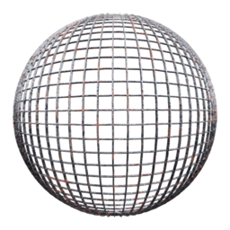</a> <b><a href="MetalWalkway001">Metal Walkway 001</a></b> by ambientCG · <a href="https://ambientcg.com/a/MetalWalkway001">source</a> | <a href="MetalWalkway002">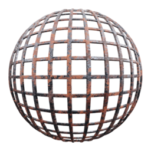</a> <b><a href="MetalWalkway002">Metal Walkway 002</a></b> by ambientCG · <a href="https://ambientcg.com/a/MetalWalkway002">source</a> | <a href="MetalWalkway003">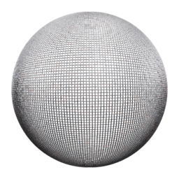</a> <b><a href="MetalWalkway003">Metal Walkway 003</a></b> by ambientCG · <a href="https://ambientcg.com/a/MetalWalkway003">source</a> | <a href="MetalWalkway004">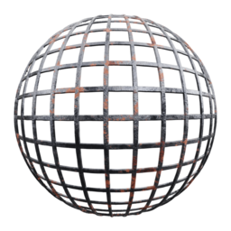</a> <b><a href="MetalWalkway004">Metal Walkway 004</a></b> by ambientCG · <a href="https://ambientcg.com/a/MetalWalkway004">source</a> |
| <a href="MetalWalkway005">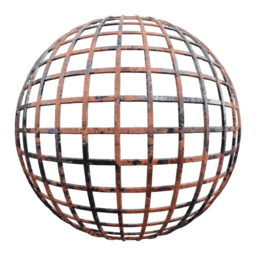</a> <b><a href="MetalWalkway005">Metal Walkway 005</a></b> by ambientCG · <a href="https://ambientcg.com/a/MetalWalkway005">source</a> | <a href="MetalWalkway006">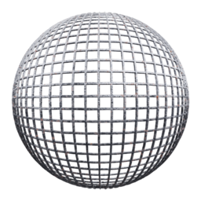</a> <b><a href="MetalWalkway006">Metal Walkway 006</a></b> by ambientCG · <a href="https://ambientcg.com/a/MetalWalkway006">source</a> | <a href="MetalWalkway007">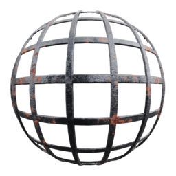</a> <b><a href="MetalWalkway007">Metal Walkway 007</a></b> by ambientCG · <a href="https://ambientcg.com/a/MetalWalkway007">source</a> | <a href="MetalWalkway008">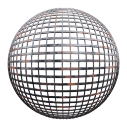</a> <b><a href="MetalWalkway008">Metal Walkway 008</a></b> by ambientCG · <a href="https://ambientcg.com/a/MetalWalkway008">source</a> |
| <a href="MetalWalkway009">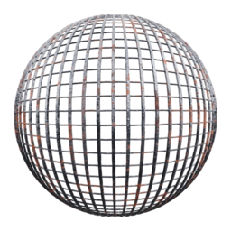</a> <b><a href="MetalWalkway009">Metal Walkway 009</a></b> by ambientCG · <a href="https://ambientcg.com/a/MetalWalkway009">source</a> | <a href="MetalWalkway010">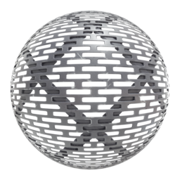</a> <b><a href="MetalWalkway010">Metal Walkway 010</a></b> by ambientCG · <a href="https://ambientcg.com/a/MetalWalkway010">source</a> | <a href="MetalWalkway011">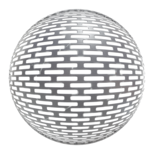</a> <b><a href="MetalWalkway011">Metal Walkway 011</a></b> by ambientCG · <a href="https://ambientcg.com/a/MetalWalkway011">source</a> | <a href="MetalWalkway012">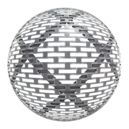</a> <b><a href="MetalWalkway012">Metal Walkway 012</a></b> by ambientCG · <a href="https://ambientcg.com/a/MetalWalkway012">source</a> |
| <a href="MetalWalkway013">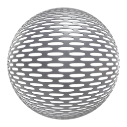</a> <b><a href="MetalWalkway013">Metal Walkway 013</a></b> by ambientCG · <a href="https://ambientcg.com/a/MetalWalkway013">source</a> | <a href="MetalWalkway014">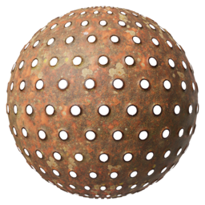</a> <b><a href="MetalWalkway014">Metal Walkway 014</a></b> by ambientCG · <a href="https://ambientcg.com/a/MetalWalkway014">source</a> |  |  |

---

Kept up to date by this repository's own [update workflow](.github/workflows/update.yml), with code and plan from [cc0-mirror](https://github.com/zuujis-cc0/cc0-mirror). Something wrong? [Open an issue there](https://github.com/zuujis-cc0/cc0-mirror/issues/new) or use the [private report form](https://games.zuujis.com/report).
